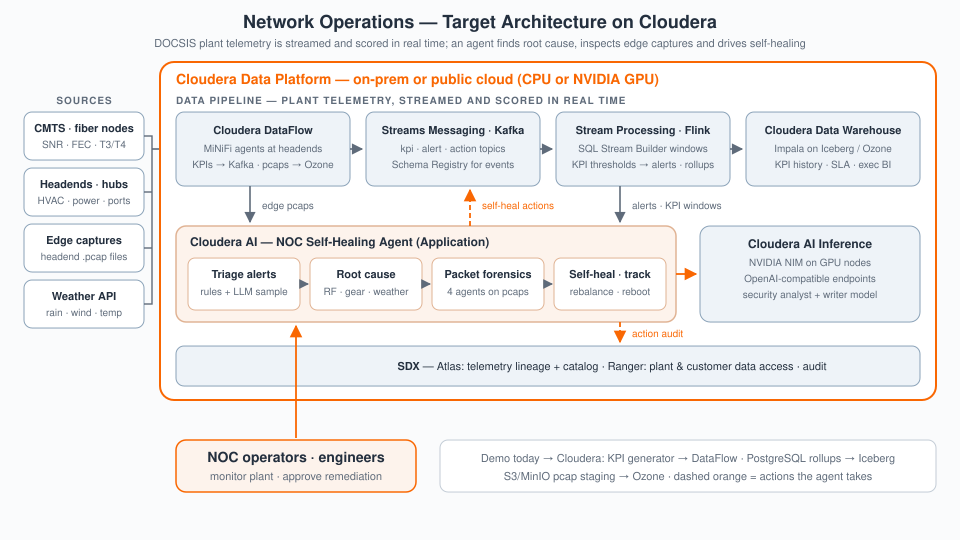

# Cloudera Blueprint: Network Lakehouse for Agentic Operations

[](LICENSE)
[](application/backend/requirements.txt)
[](METADATA.yaml)
[]()
[](https://github.com/cloudera-applied-ai/AI_Blueprint_Network-Lakehouse-for-Agentic-Operations/stargazers)
[](https://github.com/cloudera-applied-ai/AI_Blueprint_Network-Lakehouse-for-Agentic-Operations/network/members)

> AI-powered cable/ISP **network monitoring** and **autonomous self-healing** on Cloudera: plant-scale KPI telemetry, tiered PostgreSQL retention, NOC dashboards, and **Claude AI** for anomaly analysis, root-cause reasoning, and agentic remediation — with a target lakehouse architecture on **DataFlow**, **Kafka**, **CDW**, and **Cloudera AI**.

## Table of Contents

- [Overview](#overview)
- [Demo](#demo)
- [Use Case](#use-case)
- [Key Features](#key-features)
- [Quickstart / Guide](#quickstart--guide)
- [Architecture / Software Components](#architecture--software-components)
- [Target Audience](#target-audience)
- [Repository Structure](#repository-structure)
- [Prerequisites](#prerequisites)
- [Hardware Requirements](#hardware-requirements)
- [Documentation](#documentation)
- [License](#license)

## Overview

Cable Network Data Lakehouse is an AI-powered cable/ISP network monitoring and autonomous self-healing platform. It simulates a full-scale Network Operations Center (NOC) — 42 headends, 181 hubs, 7,240+ fiber nodes, ~29K amplifiers, and ~1.8M customers across 40 service areas (20 US + 20 international) — generating realistic, tiered-retention KPI telemetry, surfacing anomalies, and driving automated remediation through Claude AI. It demonstrates how a Cloudera-hosted application layer, a PostgreSQL analytical store, and an LLM integration combine into a single operator-facing platform.

## Demo

Reprise demo: https://app.getreprise.com/present/3nvwMVX 

Run it locally: `docker compose up -d`, then open the frontend at `http://localhost:8208` for the live global map, NOC dashboard, digital-twin simulation, and executive dashboard views described below.

## Use Case

Cable/ISP operators run network operations centers that must correlate KPI telemetry across tens of thousands of plant elements (headends, hubs, fiber nodes) in real time, detect degradation before it becomes an outage, and drive remediation fast enough to hold SLAs. This blueprint shows an end-to-end pattern for that problem: a realistic, tunable data generator produces plant-scale KPI volume, a tiered-retention PostgreSQL store keeps it queryable without unbounded growth, and Claude AI performs anomaly analysis, root-cause reasoning, and autonomous remediation — with every action tracked through a full lifecycle for auditability.

## Key Features

- **Real-time NOC monitoring** — 7,240+ fiber nodes across 40 service areas, 20+ KPI metrics per node (SNR, latency, throughput, packet loss, hardware telemetry), with an interactive multi-layer global map (headend → hub → fiber node → customer density).
- **AI-powered analysis** — Claude AI integration for anomaly detection, multi-source (equipment/RF/environmental) root-cause analysis, confidence-scored recommendations, and manufacturer-specific hardware manual lookup.
- **Autonomous self-healing** — automated remediation actions (load balancing, parameter optimization, node reboots, traffic rerouting) with full lifecycle tracking (PENDING → IN_PROGRESS → COMPLETED/FAILED) and effectiveness scoring.
- **Tiered data retention** — automatic rollup (raw → 1-min → 5-min → hourly → daily) keeps steady-state storage around 0.5 GB at the default 7,240-node scale instead of growing unbounded; see [Scaling Mathematics](docs/BACKEND_API_AND_DATA_GENERATION.md) for the full derivation.
- **Digital twin simulation** for what-if capacity scenarios, plus an executive dashboard with SLA tracking, financial impact metrics, and agentic multi-agent capacity planning.

## Quickstart / Guide

1. Clone the repository.
2. Fastest path — Docker Compose (requires Docker + Docker Compose only):
   ```bash
   docker compose up -d
   docker compose logs -f    # follow logs
   docker compose down       # stop
   ```
   This starts the frontend (`http://localhost:8208`), backend (`http://localhost:8008`, API docs at `/docs`), and PostgreSQL (`localhost:5434`).
3. Optional environment variables (set via `.env` at repo root or Docker Compose overrides): `ANTHROPIC_API_KEY` for Claude AI features, `API_KEY` for backend auth, `HOST_FRONTEND_PORT`/`HOST_BACKEND_PORT`/`HOST_DB_PORT` to change exposed ports, plus KPI-interval and plant-size variables covered in [BACKEND_API_AND_DATA_GENERATION.md](docs/BACKEND_API_AND_DATA_GENERATION.md).
4. To deploy as a Cloudera AI (CML) Applied ML Prototype, use `.project-metadata.yaml` and the task chain under `deploy/cml/`.

## Architecture / Software Components

**Target architecture on Cloudera.** DOCSIS plant telemetry is streamed and scored in real time; an agent finds the root cause, inspects edge packet captures and drives self-healing.

- **Cloudera DataFlow** — MiNiFi agents at the headends collect CMTS and fiber-node KPIs (SNR, FEC, T3/T4) and headend telemetry; NiFi routes KPIs to Kafka and packet captures to Ozone.
- **Cloudera Streams Messaging (Kafka)** — KPI, alert and action topics, with Schema Registry for the event schemas.
- **SQL Stream Builder (Flink)** — windowed KPI thresholds raise alerts and compute the rollups.
- **Cloudera Data Warehouse** — Impala on Iceberg / Ozone for KPI history, SLA and executive reporting.
- **Cloudera AI** — the NOC self-healing agent: triage alerts, find the root cause (RF, equipment, weather), run packet forensics on edge captures, and publish self-heal actions back to Kafka; **Cloudera AI Inference** serves the analyst and writer models.
- **SDX** — Atlas lineage and catalog for the telemetry, Ranger access control over plant and customer data, and an audit trail of agent actions.



**How the demo runs today.** A React 19 + TypeScript + Vite frontend (global map on Leaflet, NOC/executive/digital-twin dashboards, Recharts visualizations) talks to a FastAPI (Python) backend over a REST API (`/api/v1/*`, 20+ route modules). The backend runs a background generator on a rotating-slice tick (sampling `N × C / I` nodes per 30-second tick so the full plant refreshes once per KPI interval) and a data-retention service that rolls raw KPIs up through 1-minute, 5-minute, hourly, and daily tiers. All entities (FiberNode, Headend, Hub, CMTS, KPIMetrics, Alert, SelfHealingAction, CustomerAccount, LLMConfig) persist to PostgreSQL via SQLAlchemy ORM. Claude API (Anthropic) integration drives anomaly analysis and the autonomous self-healing recommendation/execution loop.

## Target Audience

- Solution architects evaluating a Cloudera-hosted, LLM-integrated network-operations reference application
- Telecom/cable field engineers and SEs running a NOC monitoring and self-healing demo
- Backend/frontend engineers interested in the FastAPI + React + tiered-PostgreSQL-retention pattern
- AI engineers interested in Claude-driven anomaly detection and agentic remediation workflows

## Repository Structure

| Path | Description |
| --- | --- |
| `assets/` | Icons and supporting media (including the executive-summary slide) |
| `deploy/` | `cml/` — CML AMP task scripts; `installer/` — setup/install tooling |
| `docs/` | `BACKEND_API_AND_DATA_GENERATION.md`, `PACKET_ANALYSIS_EDGE.md`, `presentations/` (deck-builder script) |
| `application/` | Frontend (React/Vite) and `backend/` (FastAPI) source, `Dockerfile.frontend`, `nginx.conf` |
| `docker-compose.yml` | Full local stack: PostgreSQL, backend, frontend |
| `.project-metadata.yaml` | CML AMP manifest — install/setup job chain |
| `METADATA.yaml` | Catalog metadata for the Cloudera blueprint website |

## Prerequisites

- Docker and Docker Compose (fastest path — no other tooling required)
- For local (non-Docker) development: Python 3.10+, Node.js, PostgreSQL
- Optional: an Anthropic API key (`ANTHROPIC_API_KEY`) to enable Claude AI anomaly analysis and self-healing features
- For Cloudera AI (CML) deployment: a CML workspace with JupyterLab or PBJ Workbench runtime (Python 3.12)

## Hardware Requirements

| Deployment | Minimum |
| --- | --- |
| Launchable / demo (default 7,240 nodes) | 1–3 GB RAM (frontend 100–300 MB, backend 200–500 MB, PostgreSQL 0.5–2 GB, background tasks 100–200 MB); ~0.5 GB steady-state storage |
| Larger simulated scale (10K+ nodes) | 8+ GB RAM recommended; storage scales roughly linearly (~0.7 GB at 10K nodes, ~3.5 GB at 50K nodes) |

## Documentation

- [`docs/BACKEND_API_AND_DATA_GENERATION.md`](docs/BACKEND_API_AND_DATA_GENERATION.md) — data model, scaling mathematics, API reference, generator internals
- [`docs/PACKET_ANALYSIS_EDGE.md`](docs/PACKET_ANALYSIS_EDGE.md) — edge packet-analysis component

## License

This project is licensed under the [Apache License 2.0](LICENSE).
